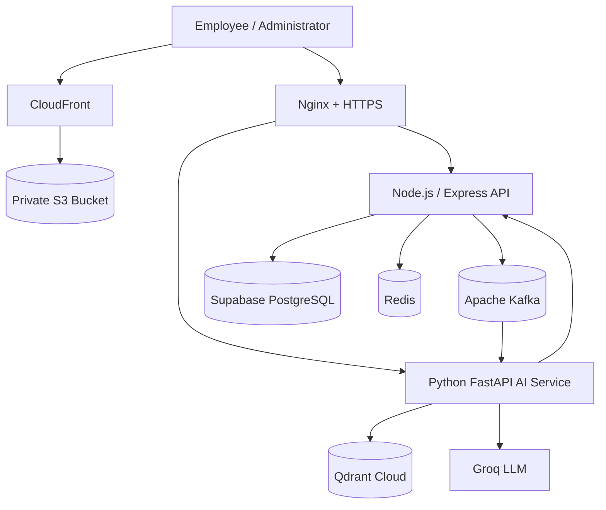
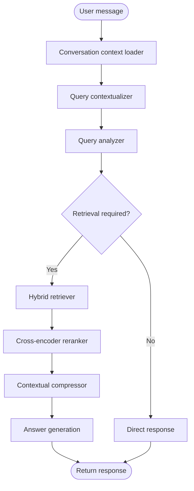
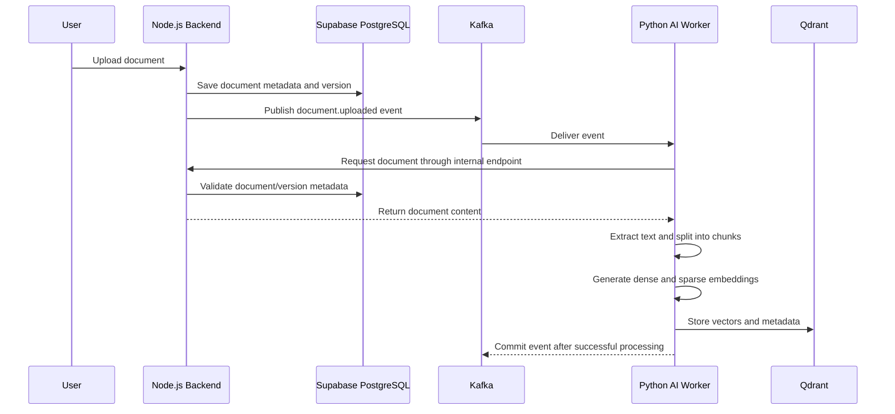

# OnBoardIQ — AI-Powered New Joiner Experience Platform

**OnBoardIQ is a full-stack, AI-powered employee onboarding platform that brings employee onboarding tasks, company documents, team information, and an enterprise knowledge assistant into one application.**

It is designed around a practical enterprise workflow: employees can complete assigned onboarding tasks, find authorized company information, and ask questions in natural language. Administrators can manage employees, teams, tasks, and documents.

> **Live application:** https://onboardiq.fahadbhati.xyz  
> **Backend API:** https://api-onboardiq.fahadbhati.xyz  
> **API documentation:** https://api-onboardiq.fahadbhati.xyz/api-docs  
> **AI service health:** https://api-onboardiq.fahadbhati.xyz/ai/api/health  
> **Repository:** https://github.com/Fahadbhati182/OnBoardIQ

---

## Contents

- [Project Overview](#project-overview)
- [Features](#features)
- [Technology Stack](#technology-stack)
- [Architecture](#architecture)
- [Project Structure](#project-structure)
- [AI and Enterprise RAG Pipeline](#ai-and-enterprise-rag-pipeline)
- [Document Ingestion Architecture](#document-ingestion-architecture)
- [Database Design](#database-design)
- [Authentication and Security](#authentication-and-security)
- [API Overview](#api-overview)
- [Local Development Setup](#local-development-setup)
- [Environment Configuration](#environment-configuration)
- [Docker Deployment](#docker-deployment)
- [AWS Production Deployment](#aws-production-deployment)
- [Build and Verification](#build-and-verification)
- [Current Implementation Notes](#current-implementation-notes)
- [Future Improvements](#future-improvements)

---

## Project Overview

New employees often need to navigate multiple systems to understand company policies, technical documentation, team processes, and onboarding responsibilities. OnBoardIQ provides a centralized experience for these activities.

The application combines three major parts:

1. **Employee experience:** dashboard, assigned onboarding tasks, progress tracking, profile, teams, and document access.
2. **Administration:** employee and team management, task creation and assignment, and document upload and publication.
3. **AI knowledge assistant:** a Python-based RAG service that ingests company documents and answers employee questions using retrieval, reranking, context compression, and an LLM.

The demo organization used while developing the platform is **Northstar Technologies Pvt. Ltd.** OnBoardIQ is an independent portfolio project inspired by enterprise onboarding systems; it is not an official product or representation of any company.

## Features

### Employee onboarding and task management

- Employee dashboard and profile.
- Onboarding task catalogue and employee-specific task assignments.
- Task states: `NOT_STARTED`, `IN_PROGRESS`, and `COMPLETED`.
- Due dates and completion timestamps.
- Employee onboarding progress.
- Admin task creation, editing, deactivation, assignment, and bulk assignment.
- Department and team organization.

### Employee and team administration

- Employee account creation and management.
- Department and team association.
- Employee team assignment.
- Role-protected administrative operations.
- Email-based password setup invitation flow.

### Document management

- PDF document upload.
- Document metadata, type, status, and access scope.
- Document publication and archive workflows.
- Document version history.
- Version-specific file metadata and storage paths.
- Document access permissions by user, role, or department.
- Internal document download endpoints for service-to-service ingestion.

### AI-powered knowledge assistant

- Persistent chat sessions and messages.
- Conversation-aware query contextualization.
- Query analysis to decide whether retrieval is required.
- Dense and sparse retrieval from Qdrant.
- Reciprocal Rank Fusion (RRF) for hybrid result fusion.
- Cross-encoder reranking.
- Contextual compression to retain relevant source information.
- LLM answer generation.
- Direct-response path for questions that do not require document retrieval.
- Separate RAG evaluation pipeline using RAGAS.

### Platform and operations

- React + TypeScript frontend.
- Node.js / Express backend.
- Python / FastAPI AI service.
- Kafka-based asynchronous document ingestion.
- PostgreSQL through Supabase.
- Qdrant vector database.
- Redis integration for caching/session-related application support.
- Docker Compose orchestration for Kafka, backend, and AI service.
- Nginx reverse proxy and HTTPS on AWS EC2.
- S3 + CloudFront frontend hosting.

---

## Technology Stack

| Layer | Technologies |
|---|---|
| Frontend | React 19, TypeScript, Vite 8, React Router, Tailwind CSS 4, Lucide React |
| Backend | Node.js 22, Express 5, JavaScript ES Modules |
| Authentication | JWT access tokens, HTTP-only refresh-token cookies, bcryptjs, RBAC |
| Database | Supabase PostgreSQL |
| Cache | Redis |
| Messaging | Apache Kafka 4, KafkaJS, kafka-python |
| AI API | Python 3.11, FastAPI, Uvicorn, Pydantic |
| LLM orchestration | LangChain, LangGraph |
| LLM provider integration | Groq through LangChain integrations |
| Dense embeddings | Sentence Transformers / Hugging Face embeddings |
| Sparse embeddings | FastEmbed |
| Vector database | Qdrant |
| Retrieval | Dense + sparse hybrid search, RRF, metadata filtering design |
| Reranking | Sentence Transformers CrossEncoder |
| Document processing | PyMuPDF, pypdf, LangChain document loaders and text splitters |
| Evaluation | RAGAS, evaluation dataset and custom pipeline runner |
| Infrastructure | Docker, Docker Compose, Nginx, Certbot |
| AWS | EC2, S3, CloudFront, ACM |
| DNS | GoDaddy |
| Version control | Git and GitHub |

---

## Architecture

OnBoardIQ uses a separated frontend, application backend, and AI service. The Node.js backend owns application authentication, authorization, and business workflows. The Python service owns RAG and document-processing workloads.



### Service responsibilities

| Service | Responsibility |
|---|---|
| React frontend | User interface, routing, authenticated API requests |
| Node.js backend | Authentication, RBAC, employees, teams, tasks, documents, chat APIs |
| PostgreSQL | Relational application data and persistent chat/task/document records |
| Redis | Optional cache layer; backend is designed to continue if Redis is unavailable |
| Kafka | Asynchronous event transport between backend and AI ingestion worker |
| Python AI service | Document ingestion, retrieval, reranking, compression, answer generation |
| Qdrant | Dense and sparse vector storage and retrieval |
| Groq | LLM inference for supported AI pipeline operations |
| S3 | Private static frontend asset storage |
| CloudFront | HTTPS content delivery for the frontend |
| Nginx | Reverse proxy from public API host to backend and AI containers |

---

## Project Structure

The following tree shows the main repository layout and the important implementation modules.

```text
OnBoardIQ/
├── client/                         # React + TypeScript frontend
│   ├── src/
│   │   ├── components/             # Reusable UI components
│   │   ├── pages/                  # Application pages
│   │   ├── services/               # API clients and service functions
│   │   ├── router.ts               # Page path mapping
│   │   ├── App.tsx                 # Application entry component
│   │   └── ...
│   ├── public/                     # Static public assets (if present)
│   ├── package.json
│   └── vite.config.ts
│
├── backend/                        # Node.js + Express application API
│   ├── src/
│   │   ├── config/                 # Redis, Kafka and service configuration
│   │   ├── controllers/            # Request handlers
│   │   ├── middleware/             # Authentication / authorization middleware
│   │   ├── routes/                 # Auth, tasks, documents, chat, teams
│   │   ├── services/               # Business and integration services
│   │   ├── utils/                  # Shared utilities and errors
│   │   ├── server.js               # Express application entry point
│   │   └── apiDocs.js              # OpenAPI specification
│   ├── Dockerfile
│   ├── package.json
│   └── .env.example
│
├── AI/                             # Python AI and RAG service
│   ├── app/
│   │   ├── agent/                  # LangGraph agent state, nodes and graph
│   │   ├── api/                    # FastAPI routers
│   │   ├── embeddings/             # Dense and sparse embedding functions
│   │   ├── evaluation/             # RAGAS metrics, evaluator and runner
│   │   ├── ingestion/               # Document ingestion and Kafka consumer
│   │   ├── retrieval/               # Hybrid search, reranker, filters, compression
│   │   ├── utils/                   # Qdrant and LLM utilities
│   │   └── main.py                  # FastAPI entry point
│   ├── Dockerfile
│   ├── pyproject.toml
│   └── uv.lock
│
├── docker-compose.yml              # Kafka, backend and AI orchestration
└── README.md
```

Some UI and service subdirectories are abbreviated above to keep the tree readable. The repository is the source of truth for the complete file list.

---

## AI and Enterprise RAG Pipeline

The AI assistant is implemented as a stateful workflow using **LangGraph**. It does not blindly retrieve documents for every user message: the query analyzer routes a message either to a retrieval path or a direct-response path.

### Agent workflow



### Retrieval stages

1. **Conversation context loading** — loads relevant conversation history for the current chat.
2. **Query contextualization** — rewrites follow-up questions into a standalone query using conversation context.
3. **Query analysis** — determines whether the request needs company-document retrieval.
4. **Hybrid retrieval** — generates dense and sparse query vectors and searches Qdrant.
5. **Fusion** — combines dense and sparse candidate rankings with Reciprocal Rank Fusion.
6. **Reranking** — uses a cross-encoder to reorder retrieved candidates against the user's query.
7. **Contextual compression** — extracts only relevant passages while preserving facts, dates, numbers, exceptions, and conditions.
8. **Answer generation** — generates a response from the selected context.
9. **Direct response** — handles messages that do not require document retrieval.

### Hybrid search

The retrieval implementation uses two complementary retrieval signals:

- **Dense retrieval:** semantic similarity using sentence-transformer embeddings.
- **Sparse retrieval:** lexical matching using FastEmbed sparse embeddings.
- **Fusion:** Qdrant prefetch with Reciprocal Rank Fusion.
- **Reranking:** a cross-encoder reranks the fused candidates.

This combination is intended to improve retrieval for both semantic questions and exact terms, policy names, identifiers, and technical vocabulary.

### Access control and metadata

Documents carry metadata such as document type, department, team, and access scope. The application schema supports the following document access scopes:

- `ALL_EMPLOYEES`
- `TEAM_ONLY`
- `ADMIN_ONLY`

The backend determines the authenticated user's identity and permissions. Retrieval filters must be applied and tested against the same authorization rules before restricted document text is sent to an LLM. Never rely on a prompt or the model itself to enforce authorization.

> **Implementation note:** The current hybrid-search source contains commented filter arguments in the Qdrant prefetch calls. Treat metadata-filter enforcement in vector retrieval as a verification item before exposing sensitive documents in production.

---

## Document Ingestion Architecture

Document ingestion is asynchronous so that file upload and AI indexing do not have to run inside the same user-facing HTTP request.



### Ingestion responsibilities

- The backend stores document metadata and version information.
- The backend publishes a `document.uploaded` Kafka event.
- The Python Kafka consumer listens to the `document.uploaded` topic.
- The worker retrieves the file using an internal backend download endpoint.
- The AI pipeline extracts text, creates chunks, generates embeddings, and indexes the content in Qdrant.
- The consumer commits the Kafka message after successful processing.

The backend exposes internal document endpoints for trusted service-to-service access. Protect these endpoints with a service credential and keep that credential out of the browser.

---

## Database Design

OnBoardIQ uses Supabase PostgreSQL for application persistence. The schema currently includes the following public tables:

| Table | Purpose |
|---|---|
| `users` | Employee and administrator profiles, roles, department and team membership |
| `departments` | Department records |
| `teams` | Team records |
| `onboarding_tasks` | Reusable onboarding task definitions |
| `employee_tasks` | Employee task assignments, status, due date and completion |
| `documents` | Document metadata, type, publication status and access scope |
| `document_versions` | Versioned document file metadata and storage paths |
| `document_permissions` | Optional per-user, per-role, or per-department document permissions |
| `employee_password_setup_tokens` | Hashed, expiring one-time employee password setup tokens |
| `refresh_sessions` | Hashed refresh tokens, expiry, revocation and session metadata |
| `chat_sessions` | Employee chat sessions |
| `chat_messages` | Messages associated with a chat session |

### Important relationships

- `users.department_id` references `departments.id`.
- `users.team_id` references `teams.id`.
- `employee_tasks.employee_id` references `users.id`.
- `employee_tasks.task_id` references `onboarding_tasks.id`.
- `documents.department_id` references `departments.id`.
- `documents.team_id` references `teams.id`.
- `document_versions.document_id` references `documents.id`.
- `document_permissions.document_id` references `documents.id`.
- `chat_sessions.employee_id` references `users.id`.
- `chat_messages.session_id` references `chat_sessions.id`.
- Refresh sessions and password setup tokens reference users.

The schema uses UUID primary keys, foreign keys, uniqueness constraints, check constraints, and indexes for important lookup paths. Document version numbers are unique per document and must be positive. A completed employee task must have a completion timestamp.

---

## Authentication and Security

### Authentication design

- Short-lived JWT access token for API authorization.
- Refresh token stored in an HTTP-only cookie.
- Refresh token hashes stored in PostgreSQL rather than storing raw refresh tokens.
- Refresh-session rotation and revocation.
- Password hashing using bcryptjs.
- One-time, expiring password setup links for invited employees.
- Cookie settings use `HttpOnly`, `Secure` in production, and `SameSite=Lax`.
- Frontend API requests include credentials so the browser can send the refresh cookie.

### Authorization

The backend enforces role-protected routes for employee and administrator operations. Current API documentation includes the engineering roles `ENGINEER` and `ENGINEERING_ADMIN`.

Document access is additionally modeled through access scopes and optional document permission records. Always enforce authorization in the backend and AI retrieval layer.

### Production security checklist

- Keep all `.env` files, tokens, service credentials, and provider API keys out of Git.
- Use strong, unique JWT secrets.
- Use HTTPS for public endpoints.
- Keep PostgreSQL, Redis, Kafka, Qdrant credentials, and internal service endpoints private.
- Do not expose container ports 3000 or 8000 publicly; route through Nginx.
- Validate and authorize internal document download requests.
- Apply least-privilege permissions to documents and vector retrieval.
- Review CORS origins and cookie settings for the production domains.
- Rotate any credential that has been accidentally committed or shared.

---

## API Overview

The Node.js API is mounted under `/api`.

| Area | Base path | Examples |
|---|---|---|
| Authentication | `/api/auth` | Login, refresh, logout, current user, employee management |
| Tasks | `/api/tasks` | My tasks, progress, task administration, assignments |
| Documents | `/api/documents` | Upload, list, update, publish, archive, download, versions |
| Chat | `/api/chat` | Create sessions, list messages, send message, rename/delete session |
| Teams | `/api/teams` | List, create, update, delete teams |

### API documentation

- Swagger UI: `/api-docs`
- OpenAPI JSON: `/api-docs.json`
- AI service Swagger UI (direct/internal service): `/docs`
- AI health endpoint: `/api/health`

The public production API documentation is available at https://api-onboardiq.fahadbhati.xyz/api-docs.

---

## Local Development Setup

### Prerequisites

- Git
- Node.js 22 or compatible current LTS
- npm
- Python 3.11+
- uv (Python package manager used by the AI Docker build)
- Docker and Docker Compose
- Supabase PostgreSQL project
- Qdrant instance
- Groq API key for LLM operations
- Redis instance (optional; the backend handles Redis unavailability)

### 1. Clone the repository

```bash
git clone https://github.com/Fahadbhati182/OnBoardIQ.git
cd OnBoardIQ
```

### 2. Configure backend

```bash
cd backend
npm ci
```

Create `backend/.env` using `backend/.env.example` as a reference. Add your Supabase URL and server-side key, JWT secrets, frontend origin, Redis settings, Kafka settings, email settings, and internal service token as required by the backend modules.

Start the backend:

```bash
npm run dev
```

The backend listens on the configured `PORT` (the Docker deployment sets it to `3000`).

### 3. Configure frontend

Open a second terminal:

```bash
cd client
npm ci
```

Create `client/.env` for local development:

```env
VITE_API_URL=http://localhost:3000/api
```

Start Vite:

```bash
npm run dev
```

The Vite development server normally runs at http://localhost:5173.

For production builds, create `client/.env.production`:

```env
VITE_API_URL=https://api-onboardiq.fahadbhati.xyz/api
```

Build the frontend:

```bash
npm run build
```

The static production output is written to `client/dist/`.

### 4. Configure AI service

The AI service uses Python 3.11 and a `pyproject.toml` / `uv.lock` dependency setup.

```bash
cd AI
uv sync
```

Create `AI/.env` with the required LLM provider, Qdrant, embedding, Kafka, and internal backend configuration.

Run FastAPI from the `AI` directory:

```bash
uv run uvicorn app.main:app --host 0.0.0.0 --port 8000 --reload
```

The AI service exposes:
- `GET /` — service welcome response.
- `GET /api/health` — health check.
- `/api/chat` — chat router.
- `/docs` — FastAPI Swagger UI.

The Kafka consumer is started in a background thread when the FastAPI application starts.

---

## Environment Configuration

Use the example files as a starting point and check the code for any additional variables required by the enabled feature set. Do not copy real credentials into this README.

### Backend — `backend/.env`

| Variable | Purpose |
|---|---|
| `PORT` | Express listen port; Docker uses 3000 |
| `FRONTEND_URL` | Allowed browser origin for credentialed CORS |
| `SUPABASE_URL` | Supabase project URL |
| `SUPABASE_PUBLISHABLE_KEY` | Supabase publishable key where required |
| `SUPABASE_SECRET_KEY` | Server-only Supabase secret key; never expose to frontend |
| `JWT_ACCESS_SECRET` | Access-token signing secret |
| `JWT_REFRESH_SECRET` | Refresh-token signing secret |
| `EMAIL_HOST`, `EMAIL_PORT`, `EMAIL_SECURE` | SMTP connection settings |
| `EMAIL_USER`, `EMAIL_PASS`, `EMAIL_FROM` | Invitation email credentials and sender |
| `REDIS_URL` or `REDIS_HOST`, `REDIS_PORT`, `REDIS_USERNAME`, `REDIS_PASSWORD` | Redis connection settings |
| `KAFKA_CLIENT_ID`, `KAFKA_DOMAIN` | Kafka producer configuration |
| `AI_BACKEND_URL` | AI service base URL |
| `ONBOARDIQ_SERVICE_TOKEN` | Internal service authentication credential, where enabled |

### Frontend — `client/.env.production`

| Variable | Purpose |
|---|---|
| `VITE_API_URL` | Public backend API base URL, including `/api` |

Vite variables prefixed with `VITE_` are bundled into the browser build. Never put secrets in frontend environment variables.

### AI service — `AI/.env`

Configure the values consumed by the AI modules, including:

- Groq API credentials and selected model settings.
- Qdrant URL, API key, and collection configuration.
- Dense embedding and cross-encoder model settings.
- Sparse embedding configuration.
- Kafka bootstrap servers.
- Backend internal URL and service authentication token.

The exact variable names are defined by the AI service's configuration modules. Keep this file private.

---

## Docker Deployment

The root `docker-compose.yml` orchestrates three containers:

| Container | Image / build | Purpose |
|---|---|---|
| `onboardiq-kafka` | `apache/kafka:4.0.0` | Single-node KRaft Kafka broker/controller |
| `onboardiq-backend` | `./backend/Dockerfile` | Express API |
| `onboardiq-ai` | `./AI/Dockerfile` | FastAPI AI service and Kafka consumer |

### Compose behavior

- Kafka uses KRaft mode; ZooKeeper is not required.
- A named Docker volume persists Kafka data.
- A named Docker volume persists uploaded document files.
- Backend and AI containers share a private Docker network with Kafka.
- Backend and AI ports are bound to host loopback (`127.0.0.1`) rather than exposed publicly.
- Backend and AI have health checks.
- The AI service waits for Kafka and backend health checks.
- Backend Redis connection is optional; the server logs a warning if Redis is unavailable.

### Start the stack

Create the environment files first:

- `backend/.env`
- `AI/.env`

Then, from the repository root:

```bash
docker compose up -d --build
```

Check services:

```bash
docker compose ps
```

Follow logs:

```bash
docker compose logs -f backend
docker compose logs -f ai
docker compose logs -f kafka
```

Restart a service after changing its environment:

```bash
docker compose up -d --force-recreate backend
```

Stop the stack:

```bash
docker compose down
```

To remove persisted Kafka and document volumes as well (destructive):

```bash
docker compose down -v
```

---

## AWS Production Deployment

The production frontend and backend/AI services are deployed separately.

### Deployment architecture

| Component | AWS / external service | Configuration |
|---|---|---|
| Frontend build | Vite | Static files from `client/dist` |
| Static asset origin | Amazon S3 | Private bucket `onboardiq-frontend-prod` |
| CDN | Amazon CloudFront | Existing distribution with Origin Access Control |
| Frontend domain | GoDaddy DNS + CloudFront | `onboardiq.fahadbhati.xyz` |
| TLS certificate | AWS Certificate Manager | Public certificate in `us-east-1` |
| Backend and AI host | EC2 Ubuntu | Docker Compose |
| Reverse proxy | Nginx | Public API host routes to local containers |
| API domain | GoDaddy DNS + EC2 | `api-onboardiq.fahadbhati.xyz` |
| HTTPS for API | Certbot / Let's Encrypt | Nginx TLS configuration |
| Relational database | Supabase | Hosted PostgreSQL |
| Vector database | Qdrant Cloud | Hosted vector collection |
| Cache | Redis Cloud | Remote Redis connection |
| Messaging | Kafka | Self-hosted in Docker Compose on EC2 |

### Frontend deployment: S3 + CloudFront

1. Set `VITE_API_URL` in `client/.env.production`:

   ```env
   VITE_API_URL=https://api-onboardiq.fahadbhati.xyz/api
   ```

2. Build the frontend:

   ```bash
   cd client
   npm ci
   npm run build
   ```

3. Upload the **contents** of `client/dist/` to the root of the private S3 bucket `onboardiq-frontend-prod`. Do not upload the enclosing `dist` directory.

4. Configure CloudFront with:
   - S3 REST origin for the bucket.
   - Origin Access Control (OAC) with signed requests.
   - S3 bucket policy granting the distribution `s3:GetObject`.
   - Viewer protocol policy: redirect HTTP to HTTPS.
   - Allowed methods: GET and HEAD.
   - Cache policy: CachingOptimized.
   - Compression enabled.
   - Default root object: `index.html`.
   - Alternate domain: `onboardiq.fahadbhati.xyz`.
   - ACM certificate issued in `us-east-1`.

5. Configure React Router fallback with CloudFront custom error responses:
   - HTTP 403 → `/index.html`, response code 200, error cache TTL 0.
   - HTTP 404 → `/index.html`, response code 200, error cache TTL 0.

6. In GoDaddy, create a CNAME record:

   | Type | Host | Value |
   |---|---|---|
   | CNAME | `onboardiq` | Your CloudFront distribution domain |

7. After uploading new assets, create a CloudFront invalidation for `/*` if cached content needs to be refreshed.

### Backend and AI deployment: EC2 + Docker Compose

1. Launch an Ubuntu EC2 instance in the Mumbai region (`ap-south-1`).
2. Install Docker Engine and the Docker Compose plugin.
3. Clone the repository onto the instance.
4. Create production `backend/.env` and `AI/.env` files on the EC2 host.
5. Configure Supabase, Redis Cloud, Qdrant Cloud, Groq, SMTP, and internal service credentials.
6. Start the containers from the repository root:

   ```bash
   docker compose up -d --build
   ```

7. Verify container health:

   ```bash
   docker compose ps
   ```

8. Verify backend and AI locally on the EC2 host:

   ```bash
   curl http://127.0.0.1:3000/
   curl http://127.0.0.1:8000/api/health
   ```

9. Configure Nginx as a reverse proxy:
   - `api-onboardiq.fahadbhati.xyz` → `http://127.0.0.1:3000`
   - `/ai/` → `http://127.0.0.1:8000/` (with the path prefix stripped by Nginx)

10. Issue and install the API hostname TLS certificate using Certbot with the Nginx plugin.

11. In GoDaddy, point the API hostname to the EC2 public IPv4 address:

   | Type | Host | Value |
   |---|---|---|
   | A | `api-onboardiq` | EC2 public IPv4 address |

12. Keep ports 3000 and 8000 private. The EC2 security group should expose SSH only to trusted source IPs and HTTP/HTTPS (80/443) to the public internet as required by Nginx.

### Production URLs

- Frontend: https://onboardiq.fahadbhati.xyz
- Backend health: https://api-onboardiq.fahadbhati.xyz/
- Backend API docs: https://api-onboardiq.fahadbhati.xyz/api-docs
- AI health through Nginx: https://api-onboardiq.fahadbhati.xyz/ai/api/health

---

## Build and Verification

### Frontend

```bash
cd client
npm ci
npm run build
```

The production bundle is generated in `client/dist/`.

### Backend

```bash
cd backend
npm ci
npm test
```

### AI service

The AI dependencies are managed through `AI/pyproject.toml` and `AI/uv.lock`. Run the available evaluation scripts and API health check in the configured Python environment.

### Production smoke tests

- Open the frontend root URL over HTTPS.
- Refresh a nested frontend route such as `/dashboard`.
- Verify CSS, JavaScript, icons, and images load.
- Verify backend health and Swagger documentation.
- Verify login, logout, refresh-token renewal, and session persistence.
- Verify employee and admin authorization boundaries.
- Upload a document and confirm the Kafka ingestion event is processed.
- Verify that the document is indexed and retrievable by an authorized user.
- Verify that unauthorized users cannot retrieve restricted documents.
- Verify chat session and message persistence.
- Inspect browser Network and Console tabs for CORS, cookie, and API errors.

---

## Current Implementation Notes

This README distinguishes code and infrastructure that are present from work that still needs production verification.

- The repository contains the React client, Express backend, FastAPI service, LangGraph RAG workflow, Qdrant retrieval modules, Kafka consumer, RAGAS evaluation modules, and Docker Compose deployment.
- The live frontend is hosted through S3 and CloudFront.
- The backend and AI services run on EC2 behind Nginx.
- Supabase PostgreSQL, Qdrant Cloud, and Redis Cloud are external managed services.
- The Kafka broker is self-hosted in the Docker Compose stack.
- RAGAS evaluation code includes Faithfulness, Answer Relevancy, Context Precision, Context Recall, and Answer Correctness.
- A 26-question evaluation run was used during development; reported metrics varied by question and run. Do not treat a single sample's score as an overall system score.
- Verify end-to-end document ingestion, retrieval authorization, refresh-token behavior, and AI responses in the production environment before describing them as fully production-hardened.
- Qdrant metadata filter arguments in the current hybrid-search implementation require review because the filter arguments in the prefetch calls are commented out.

---

## Future Improvements

- Enforce and test metadata filters consistently in every dense and sparse retrieval path.
- Add automated ingestion retry, dead-letter handling, and event observability.
- Add comprehensive integration and end-to-end tests.
- Add production metrics, tracing, structured logs, and alerting.
- Add a dedicated evaluation dataset and repeatable RAG regression runs.
- Improve retrieval quality with query expansion, hybrid-weight tuning, and evaluation-driven reranking.
- Add document deletion and re-indexing lifecycle handling.
- Add rate limiting and abuse controls for authentication and AI endpoints.
- Add automated deployment and rollback workflows.
- Add infrastructure backup, restore, and disaster-recovery procedures.

---

## Author

**Fahad Bhati**

Full Stack Development | AI Engineering | Generative AI

- GitHub: https://github.com/Fahadbhati182

---

*OnBoardIQ — bringing onboarding workflows and organizational knowledge together with full-stack engineering and applied AI.*
